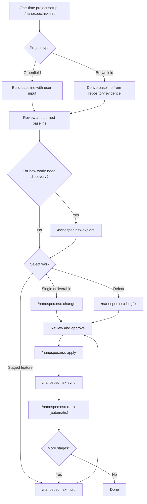

# nanospec

Lightweight, repo-based specs and change workflows for coding agents. Nanospec has no CLI of its own.

## Install

Install the `nanospec` plugin from the SHS-CT AI Toolkit marketplace. For example, with Copilot CLI and read access to this repository:

```powershell
copilot plugin marketplace add https://shs.ghe.com/SHS-CT/ai-toolkit.git
copilot plugin install nanospec@shs-ct-ai-toolkit
```

Alternatively, copy the complete `skills/nsx-*/` directories, including their references and assets, into your project's skills folder (e.g. `.github/skills/` for Copilot, `.claude/skills/` for Claude Code, or `.opencode/skills/` for OpenCode).

## Quick start

Open a coding-agent session in your project's root. The examples below use the marketplace-installed `nanospec` plugin in VS Code Copilot; enter them in chat, not a shell.

For standalone skills, VS Code Copilot and Claude Code use `/nsx-init`, while OpenCode uses `@nsx-init`. Apply the same naming pattern to the other skills. A Claude Code plugin named `nanospec` also uses `/nanospec:nsx-init`, but its plugin installation format differs.

1. Run `/nanospec:nsx-init` once when setting up nanospec for a project. For a greenfield project, it builds the baseline through a user interview; for a brownfield project, it derives a cautious, evidence-linked baseline from the existing repository. Review and correct the draft baseline before continuing. You do not rerun init for each change.
2. Run, for example, `/nanospec:nsx-change Add search filters`. Review and approve the plan. Use `/nanospec:nsx-bugfix` for a defect or `/nanospec:nsx-multi` for a staged feature instead; use `/nanospec:nsx-explore` first if the outcome is unclear.
3. Run `/nanospec:nsx-apply` to implement the approved change and verify its tasks and acceptance criteria.
4. Run `/nanospec:nsx-sync` to update the baseline. It archives a single change immediately, or a staged feature once all stages are synced. A retrospective runs automatically.

For a staged feature, use `/nanospec:nsx-multi` to plan each next dependency-ready stage, then apply and sync it. Bugfix planning establishes the root cause and normally adds a failing proof test before the fix; if an automated test is infeasible, manual reproduction requires your acceptance.

Alternatively, `/nanospec:nsx-auto <idea, bug report or change name>` coordinates the workflow, pausing for approvals and other required human decisions.

## Typical workflow



## Commands

| Skill | Purpose |
| --- | --- |
| `/nanospec:nsx-init` | Create a project baseline and agent guidance. |
| `/nanospec:nsx-explore` | Clarify an idea or project and record confirmed facts. |
| `/nanospec:nsx-change` | Plan a single feature or improvement. |
| `/nanospec:nsx-multi` | Plan a staged feature and its next ready stage. |
| `/nanospec:nsx-bugfix` | Investigate and reproduce a defect, then plan its fix. |
| `/nanospec:nsx-apply` | Implement and verify a ready change or stage. |
| `/nanospec:nsx-sync` | Update specs from verified work and archive completed changes. |
| `/nanospec:nsx-auto` | Coordinate planning, implementation and sync with human gates. |
| `/nanospec:nsx-retro` | Record qualifying lessons; runs after every successful sync. |

## Project files

- `specs/` holds the current, confirmed project baseline.
- `changes/` holds plans and their progress; completed single changes and fully synced staged features move to `changes/archive/`.
- `AGENTS.md` links the project guidance and specs. `/nanospec:nsx-init` creates or updates its nanospec section.

Change statuses progress from `draft` to `ready`, `doing`, `done` and `synced`, so work can resume across sessions.

## Developing nanospec

Edit a skill's `SKILL.md` for its workflow instructions. The single source for shared rules and templates is [`shared/rules.md`](shared/rules.md) and [`shared/templates/`](shared/templates/); each skill carries generated copies in `references/rules.md` and `assets/`. After editing `shared/`, run [`shared/Sync-NanospecShared.ps1`](shared/Sync-NanospecShared.ps1); `-Check` fails if copies are missing or stale. The script defines the template-to-skill mapping.

A pre-commit hook runs the sync and stages updated copies when a commit touches `tools/nanospec/shared/` or `tools/nanospec/skills/`. Enable it once per clone with `git config core.hooksPath .githooks`. It refuses such commits while `shared/` has unstaged changes, because the copies would not match the commit.
